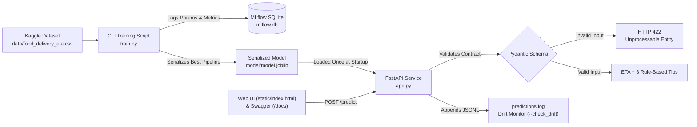

# 🛵 Food Delivery ETA Prediction System — End-to-End MLOps Pipeline

**Course:** CSL236 End-Term Project (Semester 5, B.Tech CSE, The NorthCap University)  
**Team Members:**
* **Madhavan Dixit**
* **Khushi Gupta**

---

## 1. Problem Statement & Overview

Accurate **Estimated Time of Arrival (ETA)** prediction is critical for food delivery platforms to optimize courier dispatch, set reliable customer expectations, and prevent food quality degradation. This project transforms our mid-term regression model into a **production-grade MLOps system** following the `mlops-starter` reference architecture:

* **Experiment Tracking:** Parameterized CLI training (`train.py`) logged to an **MLflow SQLite backend** (`sqlite:///mlflow.db`) across **4 configurations and 3 regression algorithms** (`Ridge`, `RandomForestRegressor`, `GradientBoostingRegressor`).
* **Single-Load Serialization:** The champion scikit-learn pipeline (`ColumnTransformer` + `GradientBoostingRegressor`) is serialized to `model/model.joblib` and loaded **once globally at FastAPI startup**.
* **Strict Data Contract Enforcement:** Every input constraint is enforced via **Pydantic v2 (`DeliveryETARequest`)**, returning **HTTP 422 Unprocessable Entity** on malformed or out-of-range payloads (never an unhandled 500 server error).
* **Interactive Web UI & Rule-Based Tips:** Served at `GET /` alongside 2–3 context-aware dispatch tips and visual feature importance bars.
* **Automated Testing, Docker & CI/CD:** Validated via 5 `pytest` tests (`tests/test_app.py`), packaged into a lean `python:3.11-slim` Docker container (`requirements-serve.txt`), and verified on every push via **GitHub Actions CI** (`.github/workflows/ci.yml`).
* **Bonus (+5 Marks):** Includes **request logging (`predictions.log`) + automated Data Drift Monitoring (`python train.py --check_drift`)** comparing live production input distributions against training baselines, plus **Feature Importance visual explanations** in the Web UI.

---

## 2. Dataset & Mandatory Data Contract Table

* **Dataset Source:** [Kaggle Food Delivery Dataset (`gauravmalik26/food-delivery-dataset`)](https://www.kaggle.com/datasets/gauravmalik26/food-delivery-dataset)
* **Cleaned Dataset Location:** `data/food_delivery_eta.csv` (**38,064 rows**, **11 input features** + target `Time_taken_min`, size **2.32 MB**). Haversine distance (`distance_km`) is computed from restaurant and customer coordinates.

### Data Contract Table

Every constraint listed below is strictly enforced in `app.py` via Pydantic (`Field(ge=..., le=...)` and `Literal[...]`). Any violation automatically returns **HTTP 422 Unprocessable Entity**.

| Feature | Type | Allowed Range / Values | Why It Matters |
| :--- | :--- | :--- | :--- |
| `Delivery_person_Age` | `int` | `18` – `65` | Captures courier experience, physical stamina, and route navigation familiarity across urban zones. |
| `Delivery_person_Ratings` | `float` | `1.0` – `5.0` | Strong proxy for courier efficiency, reliability, and historical on-time delivery performance (23.1% model importance). |
| `distance_km` | `float` | `0.5` – `50.0` | Primary physical driver of transit duration (Haversine distance in kilometers between restaurant and drop-off location). |
| `Weather_conditions` | `str` | `Sunny`, `Cloudy`, `Windy`, `Fog`, `Stormy`, `Sandstorms` | Adverse weather (`Stormy`, `Fog`, `Sandstorms`) reduces visibility and forces lower safe riding speeds (17.0% importance). |
| `Road_traffic_density` | `str` | `Low`, `Medium`, `High`, `Jam` | Directly governs average road speed and intersection wait times (16.3% importance). |
| `Vehicle_condition` | `int` | `0` – `3` | Poorly maintained vehicles (`0`) experience slower acceleration and reliability issues compared to well-maintained ones (`2`–`3`). |
| `Type_of_order` | `str` | `Snack`, `Meal`, `Drinks`, `Buffet` | Reflects order packaging complexity and restaurant handover duration. |
| `Type_of_vehicle` | `str` | `motorcycle`, `scooter`, `electric_scooter`, `bicycle` | Determines top speed and ability to maneuver through congested urban corridors. |
| `multiple_deliveries` | `int` | `0` – `3` | Stacked multi-order trips (`1`–`3` additional stops) add intermediate pickup and drop-off time penalties (11.5% importance). |
| `Festival` | `str` | `No`, `Yes` | Public festival days trigger simultaneous spikes in kitchen queue times and street congestion. |
| `City` | `str` | `Metropolitian`, `Urban`, `Semi-Urban` | Encodes road network density, high-rise drop-off complexity, and traffic signal frequency. |
| **`Time_taken_min`** *(Target)* | `int` / `float` | `10` – `54` mins | Actual end-to-end delivery duration in minutes predicted by the regression pipeline. |

---

## 3. System Architecture & Repository Structure



### Repository Layout

```text
/
├── data/
│   └── food_delivery_eta.csv   # Cleaned Kaggle dataset (38,064 rows, 11 features + target)
├── model/
│   └── model.joblib            # Serialized champion Scikit-Learn Pipeline
├── static/
│   └── index.html              # Responsive Web UI + rule-based tips + feature importance
├── tests/
│   └── test_app.py             # Automated pytest suite (5 tests: health, UI, domain, 422)
├── .github/workflows/
│   └── ci.yml                  # GitHub Actions CI pipeline (train + pytest on push to main)
├── app.py                      # FastAPI service + Pydantic schema + drift logger
├── train.py                    # CLI training script + MLflow SQLite tracking + drift check
├── Dockerfile                  # Production container (python:3.11-slim + requirements-serve.txt)
├── requirements.txt            # Full development, training, and testing dependencies
├── requirements-serve.txt      # Lean serving runtime dependencies (no MLflow/pytest)
├── .gitignore                  # Ignores venv/, __pycache__/, mlruns/, predictions.log
└── README.md                   # Project documentation, Data Contract, and results
```

---

## 4. MLflow Experiment Tracking & Model Comparison

All experiments were tracked using `mlflow.set_tracking_uri("sqlite:///mlflow.db")` under the `food-delivery-eta-prediction` experiment on an 80/20 train-test split (`30,451` train rows / `7,613` test rows, `random_state=42`):

| Run Name | Algorithm | Hyperparameters | RMSE (min) ↓ | MAE (min) ↓ | $R^2$ Score ↑ | Notes |
| :--- | :--- | :--- | :---: | :---: | :---: | :--- |
| `ridge_alpha1.0` | `Ridge` | `alpha=1.0` | 5.9405 | 4.7480 | 0.5965 | Linear baseline; underfits non-linear traffic × weather interactions. |
| `random_forest_n100_d6` | `RandomForestRegressor` | `n_estimators=100, max_depth=6` | 5.4147 | 4.1889 | 0.6648 | Reference CLI configuration; captures basic tree splits. |
| `random_forest_n150_d10` | `RandomForestRegressor` | `n_estimators=150, max_depth=10` | 3.8785 | 3.1319 | 0.8280 | Strong non-linear accuracy, larger artifact size (~13.9 MB). |
| **`gradient_boosting_n120_d6`** | **`GradientBoostingRegressor`** | **`n_estimators=120, max_depth=6, lr=0.1`** | **3.7726** | **3.0403** | **0.8373** | **Champion Model (`model/model.joblib`) — lowest RMSE & compact (~0.6 MB).** |

---

## 5. Quickstart & Reference Commands

### 1. Environment Setup
```bash
python3 -m venv venv && source venv/bin/activate
# On Windows PowerShell: .\venv\Scripts\Activate.ps1
pip install -r requirements.txt
```

### 2. Model Training & MLflow Dashboard
```bash
# Reference training command
python train.py --n_estimators 100 --max_depth 6

# Train champion Gradient Boosting model
python train.py --model_type gradient_boosting --n_estimators 120 --max_depth 6 --learning_rate 0.1

# Launch MLflow UI backed by SQLite
mlflow ui --backend-store-uri sqlite:///mlflow.db
```

### 3. Run FastAPI Server & Web UI Locally
```bash
uvicorn app:app --reload --port 8000
```
* **Web UI:** `http://127.0.0.1:8000/`
* **Interactive Swagger Docs:** `http://127.0.0.1:8000/docs`
* **Health Check:** `http://127.0.0.1:8000/health`

### 4. Run Automated Tests (`pytest`)
```bash
pytest -v --tb=short
```

### 5. Bonus (+5 Marks): Run Data Drift Check
Every valid prediction request to `POST /predict` is logged as JSONL to `predictions.log`. Compare live production feature distributions (mean, std, and Z-shift) against the training dataset baseline:
```bash
python train.py --check_drift
```

### 6. Build & Run Production Docker Container
```bash
docker build -t food-delivery-eta .
docker run -d -p 8000:8000 --restart unless-stopped food-delivery-eta
```

---

## 6. Team Contributions

| Team Member | Key Responsibilities |
| :--- | :--- |
| **Madhavan Dixit** | Repository structure, environment isolation (`requirements.txt` / `requirements-serve.txt`), dataset cleaning & Haversine feature engineering (`data/food_delivery_eta.csv`), FastAPI backend (`app.py`), Pydantic 422 data contract enforcement, responsive Web UI (`static/index.html`), Dockerfile, and GitHub Actions CI (`ci.yml`). |
| **Khushi Gupta** | Exploratory Data Analysis (EDA), MLflow SQLite experiment tracking pipeline (`train.py`), multi-algorithm benchmarking (`Ridge`, `RandomForestRegressor`, `GradientBoostingRegressor`), model serialization (`model/model.joblib`), automated `pytest` suite (`tests/test_app.py`), and data drift monitoring (`--check_drift`). |
